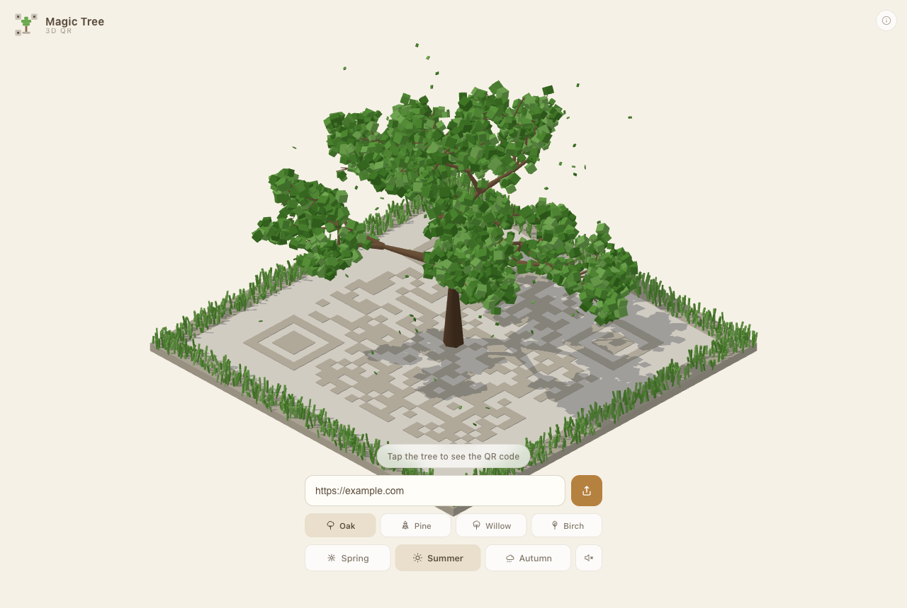

# GroveQR

URL を立体の小さな木立（grove）にし、真上から見ると読み取れる QR コードになるアプリです。



## 起動

```bash
npm install
npm run dev
```

```bash
npm test
npm run build
```

## 構成

```text
src/
  App.tsx
  sections/
    TreeSection.tsx    木（気候・樹種・季節）
  scene/               3D / QR
  audio/  ui/
docs/  docs/shots/  public/
```

## ライセンス

MIT — 詳細は [LICENSE](LICENSE)。
